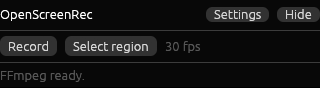

<div align="center">
  
  <p></p>
</div>

# OpenScreenRec

[](https://github.com/fanellomiramare/OpenScreenRec/actions/workflows/ci.yml)
[](LICENSE)
[](https://github.com/fanellomiramare/OpenScreenRec/releases/tag/v0.1.0-alpha)

**OpenScreenRec** is a free and open-source screen recorder, written in **100% Rust** — no Electron, no web tech, no telemetry. Lightweight, local-first and cross-platform. Your recordings never leave your machine.

> 🚧 **Early development.** The first testable builds are published as the [`v0.1.0-alpha` pre-release](https://github.com/fanellomiramare/OpenScreenRec/releases) — please [try them and report issues](.github/ISSUE_TEMPLATE/bug_report.md)! **Windows is the most-tested platform** (it is the maintainer's daily driver); macOS and Linux builds compile and are expected to work, but have seen little real-world testing — reports from those platforms are especially welcome. See [Platform status](#platform-status) for details.

## Philosophy

- **100% Rust** — the whole application, UI included (egui). No Electron, no browser engine, no web views.
- **Local-first & private** — no account, no cloud, no telemetry. Nothing ever leaves your machine.
- **Lightweight** — hardware-accelerated capture and encoding wherever the OS provides it; the recorder should be invisible to what you're doing.
- **Fully open source** — MIT licensed. Every third-party reference is credited in [Credits & references](#credits--references).

## Downloads

Grab the latest builds from the [releases page](https://github.com/fanellomiramare/OpenScreenRec/releases). The `v0.1.0-alpha` pre-release is the first testable snapshot — see the [Platform status](#platform-status) table for how well your OS is covered before installing.

### Platform status

| Platform                    | Status                                                     |
| --------------------------- | ---------------------------------------------------------- |
| **Windows**                 | most-tested (maintainer's daily driver). The unsigned installer/portable will trigger a SmartScreen warning — *More info → Run anyway*. |
| **macOS**                   | compiles and expected to work; needs real-world testing. First launch requires a one-time Gatekeeper approval — [docs/MACOS.md](docs/MACOS.md). Prefer the Homebrew cask when available. |
| **Linux (X11)**             | X11 capture is functionally tested in CI (Xvfb) but deserves more desktop testing. |
| **Linux (Wayland)**         | experimental: compiles, never verified on a live session. Uses the desktop portal; requires `xdg-desktop-portal` + PipeWire. Feedback especially welcome. |

### Requirements

- **FFmpeg** must be available for encoding. If it isn't found, the app offers an in-app **Download FFmpeg** button (installs into a per-user cache; nothing is bundled). A system-wide FFmpeg on `PATH` (or `OSR_FFMPEG_PATH`) is also fine.
- **macOS**: Screen Recording (+ Microphone, if enabled) permissions — the app guides you.
- **Linux (Wayland)**: `xdg-desktop-portal` + PipeWire.

### Windows

| Package              | Download                                                                                                          |
| -------------------- | ----------------------------------------------------------------------------------------------------------------- |
| Installer (`.exe`)   | [openscreenrec-setup.exe](https://github.com/fanellomiramare/OpenScreenRec/releases/download/v0.1.0-alpha/openscreenrec-setup.exe) (NSIS) |
| Portable (`.zip`)    | [openscreenrec-windows-x64.zip](https://github.com/fanellomiramare/OpenScreenRec/releases/download/v0.1.0-alpha/openscreenrec-windows-x64.zip) |

### macOS

| Package                       | Download                                                                                                          |
| ----------------------------- | ----------------------------------------------------------------------------------------------------------------- |
| Apple Silicon (`.dmg`)        | [openscreenrec-macos-arm64.dmg](https://github.com/fanellomiramare/OpenScreenRec/releases/download/v0.1.0-alpha/openscreenrec-macos-arm64.dmg) — first-launch notes in [docs/MACOS.md](docs/MACOS.md) |
| Intel (`.dmg`)                | building — attached automatically when the Intel runner frees up; first-launch notes in [docs/MACOS.md](docs/MACOS.md) |
| Homebrew Cask                 | cask in [packaging/](packaging/openscreenrec.rb) — no Gatekeeper prompt at all |

### Linux

| Package            | Download                                                                                                    |
| ------------------ | ----------------------------------------------------------------------------------------------------------- |
| AppImage           | [openscreenrec-linux-x64.AppImage](https://github.com/fanellomiramare/OpenScreenRec/releases/download/v0.1.0-alpha/openscreenrec-linux-x64.AppImage) — bundles its libraries |
| `.deb`             | [openscreenrec-linux-x64.deb](https://github.com/fanellomiramare/OpenScreenRec/releases/download/v0.1.0-alpha/openscreenrec-linux-x64.deb) |
| `.rpm`             | [openscreenrec-linux-x64.rpm](https://github.com/fanellomiramare/OpenScreenRec/releases/download/v0.1.0-alpha/openscreenrec-linux-x64.rpm) |
| `.tar.gz`          | [openscreenrec-linux-x64.tar.gz](https://github.com/fanellomiramare/OpenScreenRec/releases/download/v0.1.0-alpha/openscreenrec-linux-x64.tar.gz) |
| Flatpak            | planned                                                                                                     |
| AUR                | planned                                                                                                     |

> All links above point to the `v0.1.0-alpha` pre-release. The `.deb`/`.rpm` still need FFmpeg on PATH; the AppImage bundles its libraries.

Linux captures through **X11** (any desktop) or the **desktop portal** (Wayland — GNOME/KDE show the source-picker dialog; needs `xdg-desktop-portal` and PipeWire, standard on modern distros).

## Build from source

Requirements: [Rust](https://rustup.rs) 1.85+ (the toolchain file pins `stable`).

```sh
git clone https://github.com/fanellomiramare/OpenScreenRec
cd OpenScreenRec
cargo build --release
```

Run it:

```sh
./target/release/openscreenrec        # Linux / macOS
target\release\openscreenrec.exe      # Windows
```

## Roadmap

| Milestone | Scope                                                                       | Status |
| --------- | --------------------------------------------------------------------------- | ------ |
| **M0**    | Workspace, CI on 3 OS, licensing, docs, release automation                  | ✅     |
| **M1**    | Video capture (Windows first) → MP4 via FFmpeg pipe                         | ✅     |
| **M2**    | Microphone + system audio, A/V sync, pause                                  | ✅     |
| **M3**    | Floating toolbar, hotkeys, tray, region picker — **MVP complete**           | ✅     |
| **M4**    | macOS backend (ScreenCaptureKit, permissions, TCC, .dmg)                    | ✅     |
| **M5**    | Linux backend (X11 / Wayland portal) + installers for all three OS          | ✅     |
| **M6**    | Hardware encoders, window capture, audio tracks, GIF/WebM, replay buffer, webcam PiP | 🚧 |

## Repository layout

```
OpenScreenRec/
├─ src/                # the application (egui UI, orchestration)
├─ libs/
│  ├─ capture/         # osr-capture — FrameSource trait + per-OS backends
│  ├─ audio/           # osr-audio   — mic + system loopback capture, mixing
│  ├─ encode/          # osr-encode  — video/audio compression
│  ├─ mux/             # osr-mux     — container writing (MP4/MKV/WebM)
│  └─ common/          # osr-common  — config, paths, shared helpers
├─ docs/               # architecture notes
├─ appimage/ flatpak/  # Linux packaging (with M5)
└─ .github/workflows/  # CI (3 OS), release-plz, release artifacts
```

See [docs/ARCHITECTURE.md](docs/ARCHITECTURE.md) for the pipeline design.

## Credits & references

OpenScreenRec is written from scratch. These are the open-source projects that inspire its design, and the libraries it builds on — all credited where used:

**Design inspiration**

- [RustDesk](https://github.com/rustdesk/rustdesk) — repository structure and multi-OS release organization
- [Cap](https://github.com/CapSoftware/Cap) and its [scap](https://github.com/CapSoftware/scap) crate — cross-platform capture design
- [GPU Screen Recorder](https://github.com/dec05eba/gpu_screen_recorder) — GPU-first, low-impact recording
- [OBS Studio](https://github.com/obsproject/obs-studio) and [Kooha](https://github.com/SeaDve/Kooha) — feature model
- [vokoscreenNG](https://github.com/e-koch/vokoscreenNG), [Kap](https://github.com/wulkano/Kap), [ScreenToGif](https://github.com/NickeManarin/ScreenToGif) — small-but-useful features

**Key Rust crates**

- [egui](https://github.com/emilk/egui) — the UI
- [windows-capture](https://github.com/NiiightmareXD/windows-capture) — Windows Graphics Capture backend
- [screencapturekit](https://github.com/svtslf/screencapturekit) — macOS capture backend
- [cpal](https://github.com/RustAudio/cpal) — audio input
- [tray-icon](https://github.com/tauri-apps/tray-icon) and [global-hotkey](https://github.com/tauri-apps/global-hotkey) — desktop integration
- [release-plz](https://github.com/MarcoIeni/release-plz) — automated versioning and changelogs

## Contributing

Contributions are welcome! Read [CONTRIBUTING.md](CONTRIBUTING.md) to get started — the short version: Conventional Commits, CI must pass on all three platforms, and every dependency must keep the project MIT-clean.

## License

[MIT](LICENSE) — © The OpenScreenRec Contributors. Third-party crate licenses are continuously checked in CI with [cargo-deny](https://github.com/EmbarkStudios/cargo-deny).
